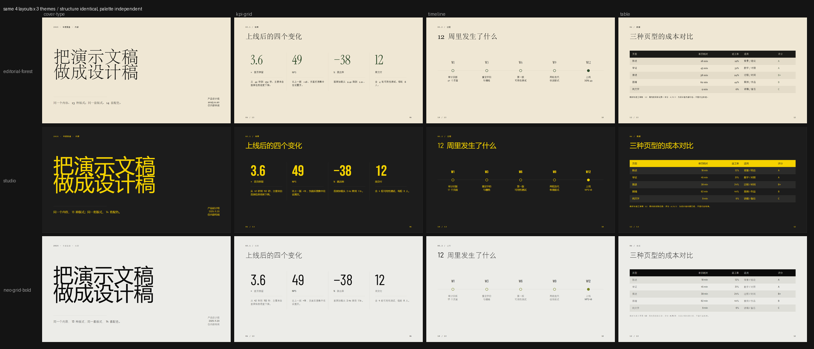
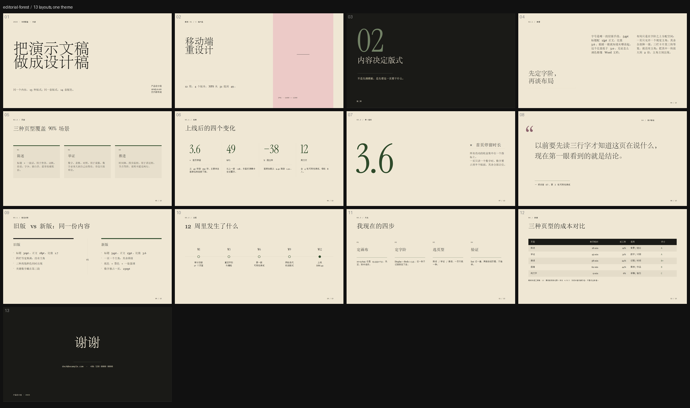

# pptx-deck-kit

[](https://github.com/HycJack/pptx-deck-kit/actions/workflows/ci.yml)

**把「HTML 模板库里的设计感」搬进真正的 .pptx：14 套主题 × 13 种版式 = 182 种页面，
外带一个会挑错的 linter 和一套必须看渲染图才算完的验收流程。**

Anything that turns Markdown/HTML into slides writes rectangles. What makes a deck look
designed is two orthogonal axes — a **palette/type axis** and a **layout axis** — plus a
checker that refuses to ship text you can't read. This repo is that whole loop, packaged
both as a CLI and as an agent skill.



*同一批版式换三套主题：结构逐像素一致，配色完全独立。*

## 为什么会有这个仓库

常见的两条路都不够用：

| 路线 | 结果 |
|---|---|
| `pandoc` / 生成器自带的 HTML→PPTX | 每块只有一种字号、只能画矩形、y 递增排布 → **像 Word 文档** |
| 找现成模板套 | 版式被模板锁死，换主题就崩；中文一行就顶破 |

所以这里把三件事拆开，各自可替换：

1. **写文件**：Go 的 [genppt](https://github.com/CoolBanHub/genppt)（内嵌并打了补丁，见下）
2. **做设计**：`skill/scripts/layouts.py` 的 13 个版式 + `skill/assets/themes.json` 的 14 套主题，
   几何全部由 12 栏栅格和字号阶推导，不写死坐标
3. **验收**：`lint_pptx.py`（8 条规则）+ LibreOffice 渲染逐页看图

## 30 秒上手

```bash
git clone https://github.com/HycJack/pptx-deck-kit
cd pptx-deck-kit
pip install -r requirements.txt

# 13 种版式排一份完整 deck（默认主题 纸与墨）
python skill/scripts/preview_layouts.py out.pptx --theme editorial-forest

# 只排指定版式，换一套主题：黑黄车间
python skill/scripts/preview_layouts.py out.pptx --theme studio --only cover-type,kpi-grid,table

# 列出版式
python skill/scripts/preview_layouts.py --list

# 14 套主题排成一张样张（配色验收用）
python skill/scripts/preview_themes.py theme-sheet.pptx

# 自检：越界 / 重叠 / 文字溢出 / 字号阶 / 文字与局部底色对比度 / 主题蓝残留 / 中文缺 a:ea / 中文两端对齐
python skill/scripts/lint_pptx.py out.pptx
```

要用自己的内容：改 `skill/scripts/preview_layouts.py` 里的 `CONTENT`，或直接调

```python
import sys; sys.path.insert(0, "skill/scripts")
from layouts import build_slide          # noqa: E402
build_slide(prs, theme_json, "kpi-grid", {"kicker": ..., "title": ..., "kpis": [...]}, num=4, total=13)
```

每个版式要哪些字段，见 [`skill/references/layouts.md`](skill/references/layouts.md)。

## 作为 agent skill 使用

`skill/` 就是一份可直接安装的技能包：`SKILL.md` 是入口（选工具 → 五步流程 → 22 条坑 → 验收清单），
`references/` 是按需展开的长文档，`scripts/` 里全是能直接跑的命令。

```bash
# 装进 DSH / Claude 等支持 skill 目录的 agent
cp -r skill ~/.dsh/skills/generating-pptx-decks        # Windows: %USERPROFILE%\.dsh\skills\...
```

不装也能用：`python skill/scripts/preview_layouts.py ...` 就是全部能力，SKILL.md 只是把
「什么时候该用哪条命令、哪些坑必须避开」写清楚。

## 两条轴

### 主题（14 套，来自 34 个 HTML 模板）

`skill/assets/themes.json` 是从 [beautiful-html-templates](https://github.com/zarazhangrui/beautiful-html-templates)
（基线 `e5e204f`）派生的**注册表**，不是抄色卡：每套都算好了角色色、真实对比度、字号阶、
字体预设和降级链。14 套可用，另有 14 套标注 `ppt_safe:false` 并写明卡在哪（多半是渐变背景或图片依赖）。

| 主题 slug | 中文名 | 纸色 | 强调色 | 备注 |
|---|---|---|---|---|
| `editorial-forest` | 纸与墨 | `#efe7d4` | `#2e4a2a` | 默认；serif 编辑感 |
| `cobalt-grid` | 电光蓝 | `#F0EBDE` | `#5560E5` | 墨色就是蓝，技术稿 |
| `signal` | 夜航金 | `#1c2644` | `#c8a870` | 深底，正式 |
| `neo-grid-bold` | 酸绿网格 | `#ECECE8` | `#E6FF3D` | 强调只能当**块** |
| `bold-poster` | 黑红宣言 | `#F5F2EF` | `#D8000F` | 海报字 |
| `monochrome` | 素纸 | `#fafadf` | `#5e5e54` | 极简长文 |
| `biennale-yellow` | 双年展黄 | `#E9E5DB` | `#F1EE2E` | 强调只能当**块** |
| `mat` | 苔绿琥珀 | `#232e26` | `#c07030` | 深底 |
| `long-table` | 长桌赭红 | `#FAF1E2` | `#B53D2A` | 文化向 |
| `soft-editorial` | 柔和三色 | `#F2EEDF` | `#E1A4C2` | 强调只能当**块** |
| `emerald-editorial` | 祖母绿 | `#F1E9D6` | `#3CD896` | 强调只能当**块** |
| `studio` | 黑黄车间 | `#1c1c1c` | `#f5d200` | 深底 + 亮字 |
| `grove` | 深林砖红 | `#192b1b` | `#c8524a` | 深底 |
| `sakura-chroma` | 木色五色 | `#F1E6CB` | `#E5392A` | 强调只能当**块** |

「只能当块」= `accent_role: "block"`：这套强调色在纸色上对比度只有 1.0–3.4，
当文字会糊掉，只能铺成色块、文字反转成墨色（`stat-highlight` 会自动切这个分支）。

完整字段（`palette` / `derived_roles` / `accent_role` / `contrast` / `fonts_fallback` / `type` / `usage`）
和「怎么加一套主题」，见 [`skill/references/themes.md`](skill/references/themes.md)。

### 版式（13 种，来自 refs 单页模板的栅格签名）

| slug | 结构 | 来源模板 |
|---|---|---|
| `cover-type` | 全幅 104pt 字 + 大留白 | `cover.html` |
| `cover-split` | 左 7 栏字 / 右 5 栏整高图位 | `image-text-split` `1fr 1fr` |
| `section-divider` | 整页反色 + 180pt 章节号 | `section-divider.html` |
| `two-column-text` | 标题 4 栏 + 正文 7 栏再切两栏 | `two-column.html` |
| `three-cards` | 3 等分卡片 + 顶部强调条 | `three-column.html` |
| `kpi-grid` | 4 等分，76pt 数字 + 竖发丝线 | `kpi-grid` `repeat(4,1fr)` |
| `stat-highlight` | 230pt 单数字压左 | `stat-highlight.html` |
| `big-quote` | 150pt 引号 + 40pt 引言 | `big-quote.html` |
| `comparison` | 左 5 栏 / 中缝 VS / 右 5 栏 | `comparison` `1fr 90px 1fr` |
| `timeline` | 轴线 + 5 等分节点 | `timeline` `repeat(5,1fr)` |
| `process-steps` | 4 步编号 + 强调线 | `process-steps.html` |
| `table` | 真表格：墨色表头 + 混色斑马纹 | `table.html` |
| `closing` | 居中大字 + 等宽联系方式 | `cta` / `thanks` |



同一套 13 页换 `studio`（深底亮字）：[预览](examples/previews/layouts-studio-overview.png)。
两轴相乘 14 × 13 = 182 种页面，代码量只是 13 个函数 + 14 条色卡。

## 主题给版式的 6 个颜色 API

版式里**不许**直接用 `accent` 画字。这不是风格洁癖——实测 14 套主题里 5 套的强调色在纸色上
对比度只有 1.0–1.8（`#E6FF3D / #ECECE8 = 1.06`），当字就是彻底消失。

| 入口 | 用途 | 行为 |
|---|---|---|
| `accent_text` | 文字 | `accent_role=block` 或对比 <3.0 时自动退回墨色 |
| `accent_mark` | 细线、小圆点、顶部色条 | 太亮就往墨色混 50% |
| `accent2_mark` | 装饰引号、次要记号 | 同上 |
| `on_ink` | 反色页上的强调元素 | 整页铺墨色后，7/14 套的强调色同样会消失 |
| `tint_pair()` | 图位 / 色块 | 返回 `(块色, 字色)`，保证 4.5 |
| `accent_readable(bg)` | 压在**非纸色**底上的强调字 | 按局部底色现算：主题级 `accent_text` 只对纸色验过，表格斑马行上会掉到 2.85（grove 的砖红实测），这里逐级混到够 4.5 |

`accent` 本身只用于面积 ≥0.5in 的色块——那时候亮色才是效果，不是缺陷。

## 验收：lint 8 条 + 逐页看渲染图

`lint_pptx.py` 的规则（全部来自真实踩坑，不是理论）：

| 规则 | 查什么 |
|---|---|
| R1 | 形状越界画布 |
| R2 | 文字估算溢出（按字号分档行高，不是固定 1.35） |
| R3 | Office 默认描边 `2F5496` 残留（漏写 `noFill` 的指纹） |
| R4 | 文本框互相重叠（按对齐方式收缩到真实文字区间） |
| R5 | 字号阶 Display/Body < 3.0 |
| R6 | 中文 run 缺 `a:ea`（会掉回默认字体，一行两种字形） |
| R7 | 中文段落 `algn="just"`（实测不拉伸，纯白设） |
| R8 | 文字色 vs **局部底色**对比度 <3.0（表头那种「纸色字压墨色块」必须查局部，查整页会误报 1.00） |

全套验收一条命令（CI 跑的就是这个）：

```bash
python tasks.py verify          # 14 套主题 × 13 个版式各排一份 + lint，全绿才 exit 0
```

判据是「**读回来和写进去一致**」，不是「能打开」——PowerPoint 对非法 XML 静默丢弃。
所以再补一步渲染逐页看：

```bash
node <libreoffice-kit>/cli.js render --input out.pptx --output-dir preview-v1 --dpi 110
# 输出目录必须不存在；拿到的 PNG 逐页 read_image，不要凭坐标脑补
```

## 仓库结构

```
skill/                     ← 可以直接装进 agent 的技能包（SKILL.md + references/ + scripts/ + assets/）
  SKILL.md                 ← 入口：选工具、五步流程、21 条坑、验收清单
  references/
    design-system.md       字号阶、栅格、封面公式、怎么从参考库挖设计
    themes.md              主题注册表字段、角色纪律、字体规矩
    layouts.md             13 个版式：来源/栅格/内容契约/怎么加
    chinese-typography.md  中文字宽=字号、行距换算、避头尾、中英混排实测常数
    ooxml-effects.md       渐变/阴影/无边框/时间轴/切换的 XML 片段
    verify-with-powerpoint.md  COM 回读脚本
  scripts/
    layouts.py             13 个版式 + Theme 包装（5 个颜色 API）
    pptx_kit.py            共享排版层：Grid(12 栏)、textbox、rect、mix/contrast
    preview_layouts.py     CLI：按主题排一份完整 deck
    preview_themes.py      CLI：14 套主题样张
    build_themes.py        从 HTML 模板库重新生成注册表（平时不用跑）
    lint_pptx.py           8 条规则
    add_anim.py           批量加切换 + 错峰入场
    pptx_anim.py          动画库（p:timing）
    pptx2video.ps1        PowerPoint COM 导出 mp4
    install_fonts.py      装自带 OFL 字体（--check / --list / --dry-run；不受 .ps1 执行策略限制）
    install_fonts.ps1     同一个功能的 PowerShell 版
    genppt-effects.patch  给 genppt 加渐变/阴影/图层/动画的补丁
  assets/
    themes.json            14 套主题注册表
    fonts/                 6 个 OFL 字体 + 许可证
tasks.py                   ← 统一入口：list / preview / sheet / lint / render / fonts
vendor/genppt/             ← 内嵌的 Go 写入器（MIT，见 NOTICE.md）
examples/                  ← 4 个成品 pptx + 5 张预览图
LICENSE / NOTICE.md        代码 MIT；第三方与字体授权
requirements.txt           唯一硬依赖：python-pptx
```

## 字体

`skill/assets/fonts/` 里是 6 个 OFL 字体（Instrument Serif、Bebas Neue、Barlow、Barlow Condensed、
IBM Plex Mono 等），**只用于 display 层**；正文一律走系统字体，这样换机器不会掉版。

```bash
python tasks.py fonts --check     # 查缺（缺则退出码 1）
python tasks.py fonts             # 安装：管理员→全机；否则→仅当前用户
python tasks.py fonts --list      # 列 14 套主题各自用到的族
```

PowerShell 版 `skill/scripts/install_fonts.ps1` 功能等价。**如果你的机器执行策略是 AllSigned**
（常见于组策略下发的公司机），`.ps1` 会因为「未数字签名」直接拒绝运行，`-ExecutionPolicy Bypass`
也覆盖不了组策略——那就用 `.py` 版：安装字体本质就是拷文件 + 写注册表 + `AddFontResourceW`，
这三件事 Python 都能做，不受脚本策略影响。

中文没有自带：Windows 用 `华文宋体`/`微软雅黑`/`等线 Light`，macOS 用 `Songti SC`/`PingFang SC`。
PowerPoint 文件里只存字体名，**不存字形**——`EmbedTrueTypeFonts` 是 Word 的属性，PowerPoint COM 没有这个开关，
所以「换机器不掉版」只能靠降级链。

## genppt 为什么内嵌而不是 submodule

- 这个仓库要能 clone 完直接跑（Go 只用来重写 XML，不装也能用 Python 那条路）
- 本地对 genppt 打过补丁（渐变/阴影/图层/动画），补丁也在 `skill/scripts/genppt-effects.patch`
- 上游是 MIT，内嵌合法，详见 [NOTICE.md](NOTICE.md)（含 pin 的 commit）

## 已知边界

- 多栏版式别用 10×5.625 画布，栏宽会挤到 3in 以下；默认 13.333×7.5
- 参考库里另有 7 个模板没做成版式：`image-gallery` / `image-grid` / `chart-*` / `gantt` /
  `roadmap` / `mindmap` / `code`——它们依赖真实图片或数据源，做成空版式只是占位框
- 动画/切换只能通过 PowerPoint COM 回读验证，纯 Python 校验不了
- `themes.json` 里 `ppt_safe:false` 的 14 套是真不能用（渐变底、图片依赖），不是没写完

## License

代码 MIT（见 [LICENSE](LICENSE)）。第三方：genppt（MIT）、6 个字体（OFL 1.1，分发必须带
`*-OFL.txt`）、主题派生自 beautiful-html-templates（见 [NOTICE.md](NOTICE.md)）。
